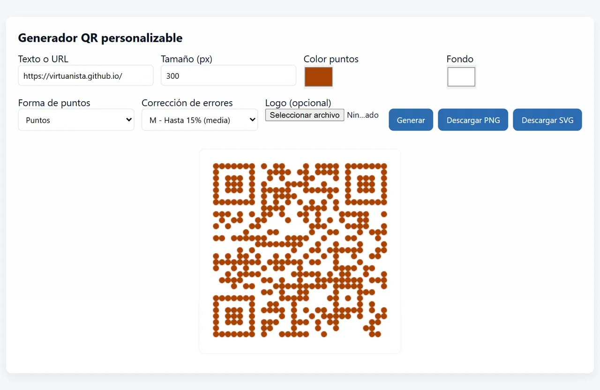

<a href="README.md">Español</a> · <b>English</b>

# QR Generator

Create custom QR codes in your browser: **[virtuanista.github.io/qr-code](https://virtuanista.github.io/qr-code/)**.

- Text or URL, size, colors, dot shape and error correction.
- Optional logo in the center.
- Download as PNG or SVG.

Everything happens in your browser and there is no server. You can also open `index.html` directly; it needs a connection to load the library.

## License

Code under [MIT](LICENSE). Uses [qr-code-styling](https://github.com/kozakdenys/qr-code-styling) (MIT), by its authors.

	Repository made by <a href="https://github.com/virtuanista" target="_blank">virtu 🎣</a>

	

	Copyright &copy; 2026

	

