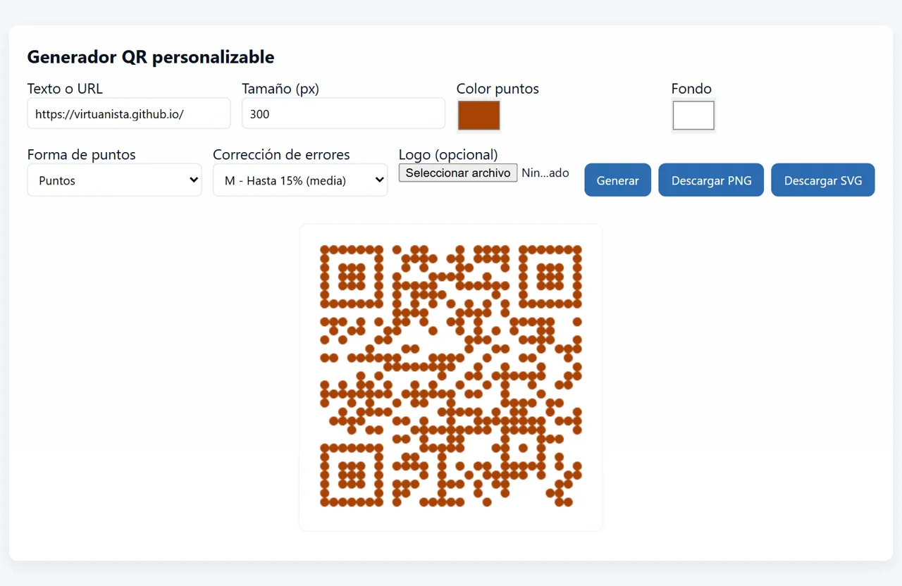

# Generador QR

Crea códigos QR personalizados en el navegador: **[virtuanista.github.io/qr-code](https://virtuanista.github.io/qr-code/)**.

- Texto o URL, tamaño, colores, forma de los puntos y corrección de errores.
- Logo opcional en el centro.
- Descarga en PNG o SVG.

Todo ocurre en tu navegador y no hay servidor. También puedes abrir `index.html` directamente; necesita conexión para cargar la librería.

## Licencia

Código bajo [MIT](LICENSE). Usa [qr-code-styling](https://github.com/kozakdenys/qr-code-styling) (MIT), de sus autores.

	Repositorio generado por <a href="https://github.com/virtuanista" target="_blank">virtu 🎣</a>

	

	Copyright &copy; 2026

	

